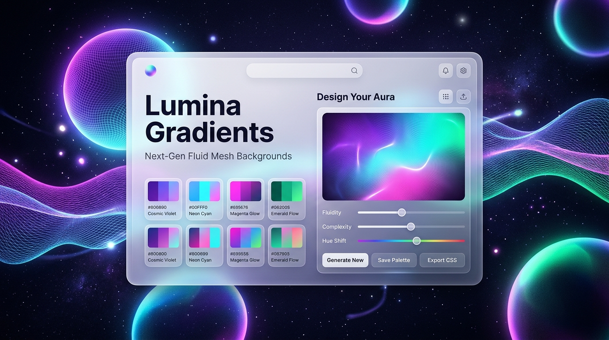

# Lumina Gradients ✨

> Next-Generation GPU-Accelerated Animated Fluid Mesh Backgrounds & Interactive Studio.



---

## 🌟 Overview

**Lumina Gradients** is an interactive web studio that renders silky-smooth, continuous multi-point fluid mesh gradient backgrounds. Built with performance and aesthetics at its core, it replaces CPU-heavy `background-position` animations with hardware-accelerated GPU transforms (`translate3d` and `rotate`), delivering effortless 60–120 FPS motion with zero layout recalculation.

---

## 🚀 Key Features

- **⚡ GPU-Accelerated Mesh Engine**: Multi-layered blurred orbs animated directly on the GPU for fluid 60–120 FPS animations without battery drain.
- **🎨 Curated Modern Palettes**: Handcrafted color schemes including *Cosmic Nebula*, *Aurora Borealis*, *Sunset Velvet*, *Oceanic Abyss*, *Cyberpunk Neon*, and *Citrus Bloom*.
- **🎲 Harmonic Palette Generator**: Generate mathematically balanced, analogous and triadic color schemes with matching dark bases at the press of <kbd>Space</kbd>.
- **🔮 Frosted Glassmorphism**: High-contrast translucent cards and controls with dynamic glowing borders and micro-film grain texture.
- **👁️ Pure View (Zen Mode)**: Hide the center card or all UI controls with one click to enjoy the pristine background unobstructed.
- **⛶ Native Fullscreen**: One-click fullscreen toggle (<kbd>F</kbd>) for ambient display and monitor screensavers.
- **📋 One-Click CSS Export**: Copy production-ready multi-stop radial and linear CSS rules directly to your clipboard.
- **📱 100% Mobile Friendly**: Engineered with `100dvh` (Dynamic Viewport Height) to eliminate URL bar jump glitches, accompanied by an adaptive **Grid View** toggle that displays all color tabs cleanly on mobile devices.

---

## ⌨️ Keyboard Shortcuts

| Shortcut | Action |
| :---: | :--- |
| <kbd>Space</kbd> | Generate a new harmonic gradient |
| <kbd>P</kbd> | Play / Pause mesh fluid animation |
| <kbd>C</kbd> | Copy full CSS snippet to clipboard |
| <kbd>H</kbd> | Hide / Show Center Info Card |
| <kbd>Z</kbd> | Toggle Pure View (Hide all UI) |
| <kbd>F</kbd> | Toggle Fullscreen |
| <kbd>Esc</kbd> | Exit Pure View / Restore UI |

---

## 📁 Project Structure

```
lumina-gradients/
├── index.html         # Semantic structure, meta tags, OpenGraph, PWA manifest
├── style.css          # GPU mesh keyframes, glassmorphic design tokens, responsive queries
├── app.js             # Theme state, harmonic generator, shortcuts, fullscreen controller
├── favicon.svg        # Scalable SVG vector icon
├── preview.png        # High-resolution social share and repo preview banner
├── site.webmanifest   # Web app manifest for PWA and mobile home screens
├── robots.txt         # Search crawler configuration
├── sitemap.xml        # SEO sitemap
└── README.md          # Documentation
```

---

## 💻 Getting Started

No build tools or bundlers required. Simply open `index.html` in any modern web browser or serve it with any local static server.

---

## 🛠️ Built With

- **HTML5**: Semantic tags, accessibility attributes, and SEO OpenGraph tags.
- **Vanilla CSS3**: CSS Custom Properties, hardware-accelerated transforms, and backdrop filters.
- **Vanilla JavaScript (ES6+)**: Zero dependencies, lightweight DOM controller, and Fullscreen API.

---

## 📄 Copyright

Copyright © 2026. All rights reserved.
